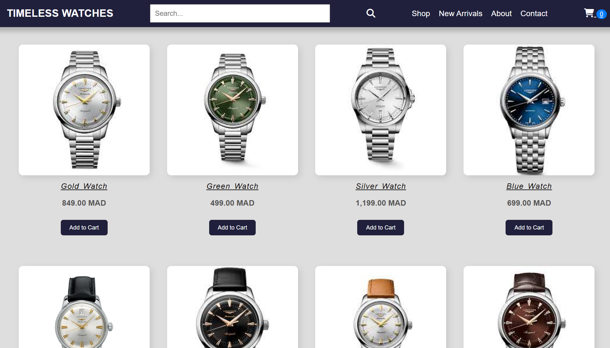
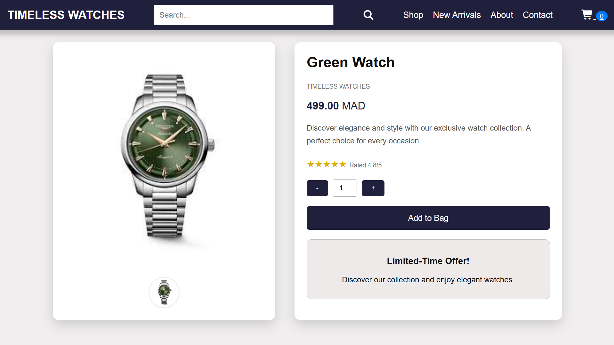
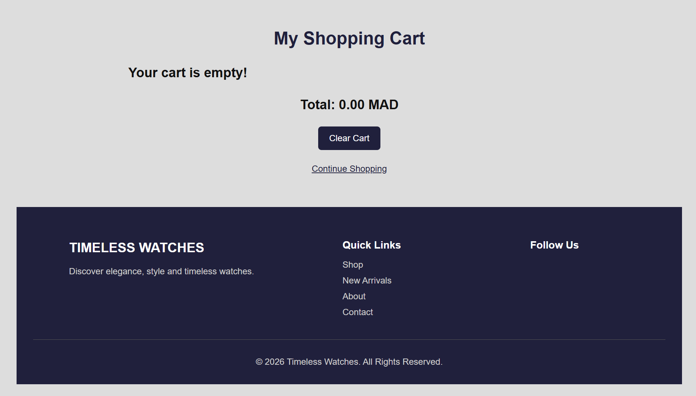
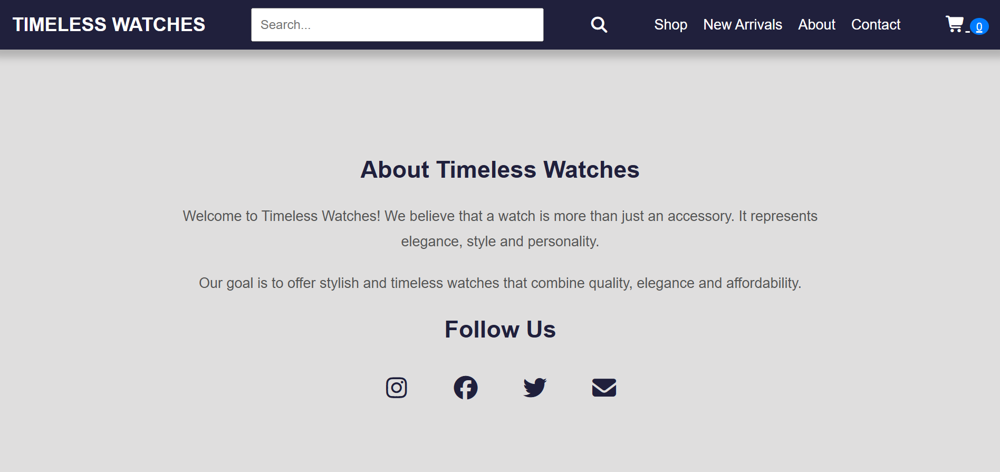
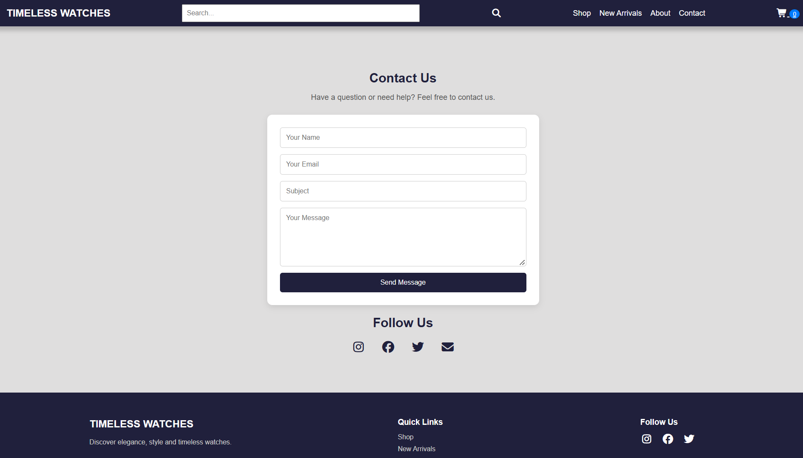
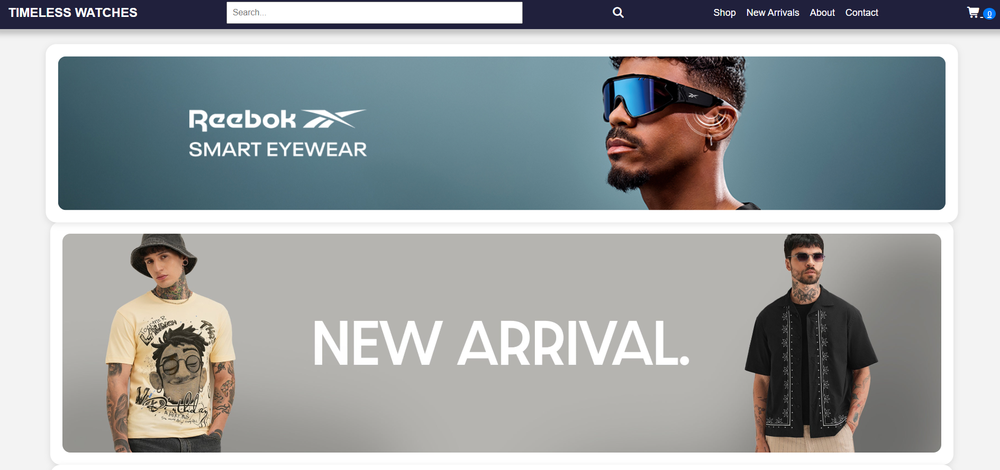

# ⌚ Timeless Watches – Mini Boutique

A responsive online watch store built using HTML, CSS, and JavaScript.

## 📌 About The Project

Timeless Watches is a mini e-commerce website where users can explore a collection of watches, view product details, and manage their shopping cart.

The project focuses on creating a simple, elegant, and user-friendly shopping experience.

## ✨ Features

- Browse a collection of watches.
- Search for products.
- View individual product details.
- Dynamic product images and prices.
- Add products to the shopping cart.
- Increase and decrease product quantities.
- Remove products from the cart.
- Calculate the total price automatically.
- Store cart data using LocalStorage.
- Contact form.
- New Arrivals page.
- Responsive product details layout.

## 🛠️ Technologies Used

- HTML5
- CSS3
- JavaScript
- Font Awesome
- LocalStorage

## 📂 Project Structure

```text
Mini-Boutique/
├── css/
├── js/
├── photos/
├── khedma.html
├── watch.html
├── cart.html
├── checkout.html
├── about.html
├── contact.html
└── new.html
```


## 📸 Screenshots

### Home Page


### Product Details


### Shopping Cart


### About


### Contact


### New Arrivals



## 🚀 Getting Started

1. Clone the repository:

```bash
git clone YOUR_REPOSITORY_URL
```

2. Open the project folder in Visual Studio Code.

3. Open `khedma.html` using Live Server.

## 🛒 Shopping Cart

The shopping cart uses JavaScript and LocalStorage to save selected products and quantities in the browser.

## ⚠️ Project Limitations

- No backend integration.
- No real payment system.
- Order confirmation is currently simulated.
- Contact form submission is not connected to a server.

## 👨‍💻 Author

Developed as a front-end web development project.

## 📄 License

This project is created for educational purposes.